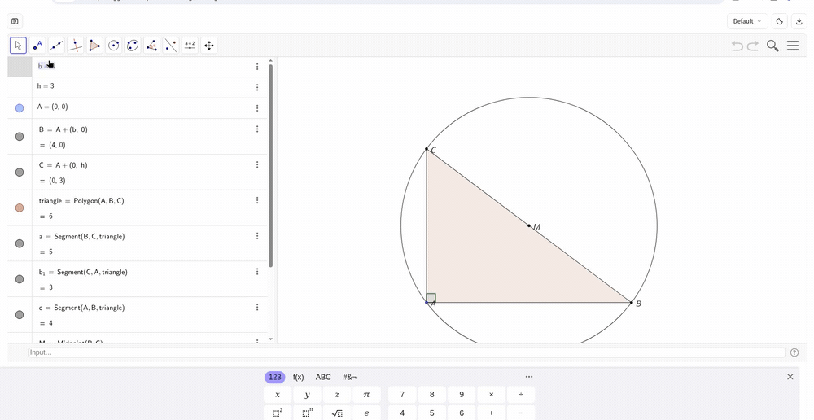

<p align="center"></p>
<h1 align="center">GeoGebra Studio</h1>

<p align="center">
  <a href="skills/geogebra-studio/SKILL.md"></a>
  <a href="https://yzdame.github.io/GeoGebra-Studio/"></a>
  <a href="https://www.npmjs.com/package/@lydt/geogebra-studio"></a>
  <a href="https://www.npmjs.com/package/dsh-geogebra-studio"></a>
  <a href="https://www.npmjs.com/package/@lydt/geogebra-studio"></a>
  <a href="LICENSE"></a>
  <a href="https://nodejs.org/"></a>
  <a href="https://github.com/YZDame/GeoGebra-Studio/stargazers"></a>
</p>

**GeoGebra Studio** ist ein standardisierter **Agent Skill** (mit optionalen Plugins für Codex und DeepSeek Harness). Beschreibe deiner KI in Claude Code, Codex, Cursor, DeepSeek Harness oder jedem Agent-Skills-Client, was du zeichnen möchtest — oder sende eine Aufgabenstellung bzw. ein Referenzbild — und erhalte eine interaktive 2D/3D-GeoGebra-Seite zum Ziehen, Bearbeiten und Exportieren. Erst einmal ausprobieren? Öffne die [interaktive Galerie auf GitHub Pages](https://yzdame.github.io/GeoGebra-Studio/) direkt im Browser, ganz ohne Installation.

[English](README.md) · [简体中文](README.zh-CN.md) · [繁體中文](README.zh-TW.md) · [Español](README.es.md) · [Français](README.fr.md) · [Deutsch](README.de.md) · [日本語](README.ja.md) · [한국어](README.ko.md) · [Português (Brasil)](README.pt-BR.md)

## Schnellstart

1. **Agent Skill installieren** (erfordert Node.js 22.12+; Optionen für Cursor-, Codex- und DeepSeek-Harness-Plugins siehe [Installation](#installation) weiter unten):

   ```sh
   npx skills add YZDame/GeoGebra-Studio --skill geogebra-studio
   ```

2. **KI um eine Zeichnung bitten**, oder ein Aufgabendokument bzw. Referenzbild hochladen (die Upload-Möglichkeiten hängen vom jeweiligen KI-Client ab):

   > Zeichne ein Dreieck und seinen Umkreis. Die Eckpunkte sollen sich verschieben lassen.

3. **Interagieren, bearbeiten und exportieren**: Öffne die erzeugte Seite, um Punkte zu verschieben und Werte anzupassen, oder bitte die KI um weitere Änderungen. **Lade vor dem Schließen oder Neuladen das aktuelle HTML oder GGB herunter, um deine Änderungen zu sichern.**

| Erzeugen | Bearbeiten | Exportieren |
| --- | --- | --- |
|  |  |  |

## Funktionen

- 2D- und 3D-GeoGebra-Figuren mit verschiebbaren Punkten, einstellbaren Werten, neun Design-Themes sowie Hell-/Dunkelmodus.
- **HTML, GGB, PNG, SVG, PDF, XML und TikZ** direkt auf der Seite herunterladen.
- Export als **Asymptote** und **gemischtes TSQX/Asymptote** über die KI; siehe [Export-Details](skills/geogebra-studio/references/exports.md).
- Portabler [`SKILL.md`](skills/geogebra-studio/SKILL.md)-Workflow ohne MCP-Server, Backend oder Datenbank.

## Installation

Läuft unter macOS, Windows und Linux mit **Node.js 22.12 oder neuer**. Dein KI-Client benötigt Datei- und Shell-Zugriff. Zum Öffnen einer erzeugten Seite ist Internetzugang erforderlich, um die offizielle GeoGebra-Engine zu laden.

**Wähle passend zu deinem KI-Client eine der folgenden Methoden:**

### 1. Allgemeine Agent-Skill-Installation (empfohlen)

Für Claude Code, Cursor, Codex und andere Clients mit Agent-Skills-Unterstützung. Folge den Eingabeaufforderungen, um Client und Installationsbereich auszuwählen.

```sh
npx skills add YZDame/GeoGebra-Studio --skill geogebra-studio
```

Alternativ kannst du den gesamten Ordner [`skills/geogebra-studio/`](skills/geogebra-studio/) in das Skills-Verzeichnis deines Clients kopieren. Behalte dabei alle Dateien neben `SKILL.md`.

### 2. Installation in Codex (optionales Plugin)

Führe den Codex-Plugin-Installer aus und öffne eine neue Codex-Sitzung.

```sh
npx @lydt/geogebra-studio@latest install
```


### 3. Installation in DeepSeek Harness (interaktives Canvas in der rechten Seitenleiste)

Öffne in der Desktop-App **Plugins → Add Plugin**, füge den untenstehenden Paketnamen ein und installiere ihn. Das Plugin bringt den `geogebra-studio`-Skill bereits mit; eine separate Skill-Installation ist nicht nötig.

```text
dsh-geogebra-studio
```

Öffne **GeoGebra Studio** in der linken Seitenleiste, um das interaktive Canvas direkt neben dem Chat zu nutzen. Die Installation per Kommandozeile beschreibt die [Plugin-Anleitung](plugins/dsh-geogebra-studio/).


### 4. Installation in Cursor (Plugin)

Nach der Veröffentlichung installierst du **GeoGebra Studio** im Cursor Marketplace. Vorher kopierst du dieses Repository nach `~/.cursor/plugins/local/geogebra-studio`, sodass die Kopie `.cursor-plugin/plugin.json` enthält, und lädst Cursor neu. Node.js 22.12 oder neuer ist erforderlich. Bitte Cursor, eine Figur zu zeichnen; der mitgelieferte Skill `geogebra-studio` schreibt eine lokale HTML-Datei. Zum Öffnen braucht der Browser Zugriff auf die offizielle GeoGebra-Engine.

Die Agent-Skill-Installation aus Abschnitt 1 funktioniert in Cursor ebenfalls.

Weitere Details findest du unter [Installation und Fehlerbehebung](skills/geogebra-studio/references/installation.md).

## Ressourcen

[Beispiele](examples/README.md) · [Interaktive Galerie](https://yzdame.github.io/GeoGebra-Studio/) · [Skill-Spezifikation](skills/geogebra-studio/SKILL.md) · [Entwicklung und Mitwirken](CONTRIBUTING.md)

Ein unabhängiges Community-Projekt, ohne Zugehörigkeit zu GeoGebra. Lizenziert unter [GPL-2.0-or-later](LICENSE), unter Beibehaltung der [früheren MIT-Hinweise](LICENSE-MIT) und [Drittanbieter-Hinweise](THIRD_PARTY_NOTICES.md).
