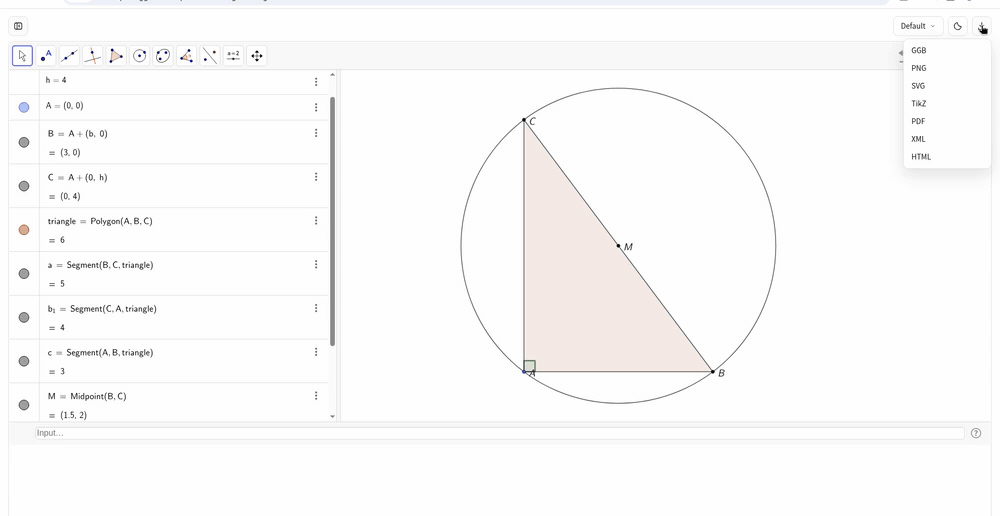
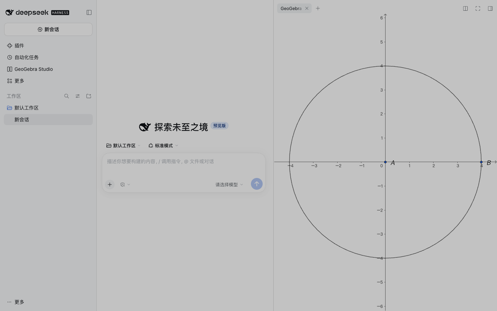

<p align="center"></p>
<h1 align="center">GeoGebra Studio</h1>

<p align="center">
  <a href="skills/geogebra-studio/SKILL.md"></a>
  <a href="https://yzdame.github.io/GeoGebra-Studio/"></a>
  <a href="https://www.npmjs.com/package/@lydt/geogebra-studio"></a>
  <a href="https://www.npmjs.com/package/dsh-geogebra-studio"></a>
  <a href="https://www.npmjs.com/package/@lydt/geogebra-studio"></a>
  <a href="LICENSE"></a>
  <a href="https://nodejs.org/"></a>
  <a href="https://github.com/YZDame/GeoGebra-Studio/stargazers"></a>
</p>

**GeoGebra Studio** は標準的な **Agent Skill** です（Codex や DeepSeek Harness 向けのプラグインも用意しています）。Claude Code、Codex、Cursor、DeepSeek Harness などの AI クライアントで、描きたい図形を文章で伝えたり、問題文書や参考画像を送ったりするだけで、ドラッグ・編集・書き出しが可能な 2D/3D GeoGebra ページを生成できます。まずは雰囲気を試したい場合は、インストール不要でブラウザーから使える[インタラクティブギャラリー（GitHub Pages）](https://yzdame.github.io/GeoGebra-Studio/)をご覧ください。

[English](README.md) · [简体中文](README.zh-CN.md) · [繁體中文](README.zh-TW.md) · [Español](README.es.md) · [Français](README.fr.md) · [Deutsch](README.de.md) · [日本語](README.ja.md) · [한국어](README.ko.md) · [Português (Brasil)](README.pt-BR.md)

## クイックスタート

1. **Agent Skill をインストール**（Node.js 22.12 以降が必要です。Codex や DeepSeek Harness プラグインについては下の[インストール](#インストール)をご覧ください）：

   ```sh
   npx skills add YZDame/GeoGebra-Studio --skill geogebra-studio
   ```

2. **AI に作図を依頼する**（問題文書や参考画像をアップロードして依頼することもできます。アップロード方法はご利用の AI クライアントに準じます）：

   > 三角形とその外接円を描いて。頂点はドラッグできるようにしてください。

3. **操作・編集・書き出し**：生成されたページを開いて点をドラッグしたり数値を調整したりできます。AI に追加の変更を頼むことも可能です。**編集内容を保存するには、ページを閉じる・再読み込みする前に現在の HTML または GGB をダウンロードしてください。**

| 生成 | 編集 | 書き出し |
| --- | --- | --- |
|  |  |  |

## 主な機能

- 自由点のドラッグや数値調整に対応した 2D／3D GeoGebra 図形、9 種類のテーマ、ライト／ダークモード。
- ページ上から **HTML、GGB、PNG、SVG、PDF、XML、TikZ** を直接ダウンロード。
- AI を通じて **Asymptote** および **TSQX/Asymptote 混合形式**のソースコードを書き出し可能（詳細は[書き出しガイド](skills/geogebra-studio/references/exports.md)を参照）。
- [`SKILL.md`](skills/geogebra-studio/SKILL.md) に基づくポータブルなワークフロー。MCP サーバー、バックエンド、データベースは不要です。

## インストール

macOS、Windows、Linux 上で **Node.js 22.12 以降**が必要です。AI クライアントにはファイル操作とコマンド実行の権限が必要です。生成したページを開く際は、GeoGebra 公式エンジンを読み込むためインターネット接続が必要です。

**ご利用の AI クライアントに合わせて、以下のいずれか 1 つの方法を選択してください：**

### 1. 汎用 Agent Skill インストール（推奨）

Claude Code、Cursor、Codex など、Agent Skills に対応するクライアント向けです。画面の案内に従ってクライアントとインストール範囲を選択してください。

```sh
npx skills add YZDame/GeoGebra-Studio --skill geogebra-studio
```

また、[`skills/geogebra-studio/`](skills/geogebra-studio/) フォルダー一式（`SKILL.md` と同階層のすべてのファイルを含む）をクライアントの Skills ディレクトリへそのままコピーする方法でも利用できます。

### 2. Codex にインストール（オプションのプラグイン）

Codex プラグインインストーラーを実行し、新しい Codex セッションを開きます。

```sh
npx @lydt/geogebra-studio@latest install
```


### 3. DeepSeek Harness にインストール（右側インタラクティブキャンバス付き）

デスクトップアプリで **Plugins → Add Plugin** を開き、以下のパッケージ名を貼り付けてインストールしてください。このプラグインには `geogebra-studio` スキルが同梱されているため、汎用インストールを別途行う必要はありません。

```text
dsh-geogebra-studio
```

左側のサイドバーから **GeoGebra Studio** を開くと、会話の横にインタラクティブなキャンバスが表示されます。コマンドラインでのインストールは[プラグインガイド](plugins/dsh-geogebra-studio/)をご覧ください。



詳しい設定やトラブルシューティングは[インストールとトラブルシューティング](skills/geogebra-studio/references/installation.md)を参照してください。

## 関連資料

[サンプル集](examples/README.md) · [インタラクティブギャラリー](https://yzdame.github.io/GeoGebra-Studio/) · [Skill 定義](skills/geogebra-studio/SKILL.md) · [開発と貢献](CONTRIBUTING.md)

GeoGebra 公式とは無関係の独立したコミュニティプロジェクトです。[GPL-2.0-or-later](LICENSE) ライセンスのもとで公開されており、[従来の MIT 表記](LICENSE-MIT)および[第三者に関する表示](THIRD_PARTY_NOTICES.md)を保持しています。
