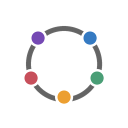
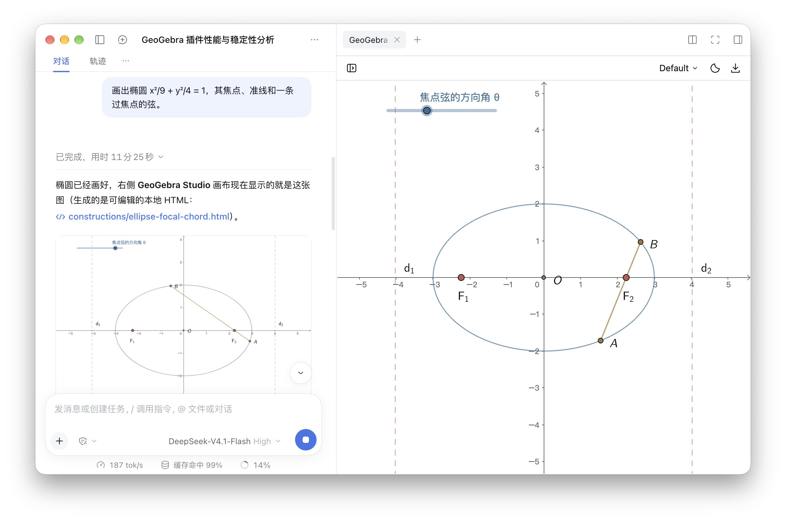

<p align="center"></p>
<h1 align="center">GeoGebra Studio</h1>

<p align="center">
  <a href="https://www.npmjs.com/package/@lydt/geogebra-studio"></a>
  <a href="https://www.npmjs.com/package/dsh-geogebra-studio"></a>
  <a href="https://www.npmjs.com/package/@lydt/geogebra-studio"></a>
  <a href="LICENSE"></a>
  <a href="https://nodejs.org/"></a>
  <a href="https://github.com/YZDame/GeoGebra-Studio/stargazers"></a>
</p>

[English](README.md) · [简体中文](README.zh-CN.md) · [繁體中文](README.zh-TW.md) · [Español](README.es.md) · [Français](README.fr.md) · [Deutsch](README.de.md) · [日本語](README.ja.md) · [한국어](README.ko.md) · [Português (Brasil)](README.pt-BR.md)

**편집 가능한 GeoGebra 수학 도형을 생성, 수정, 내보내기 위한 이식 가능한 Agent Skill입니다.**

## 사용 방법

| 생성 | 편집 | 내보내기 |
| --- | --- | --- |
|  |  |  |
| 명령 JSON에서 미리 맞춰 둔 로컬 대화형 뷰어로. | 자유 값을 바꿔도 종속 객체는 관계를 유지한다. | 하나의 작도. 실제 Download 메뉴의 일곱 가지 형식. |

## 주요 기능

- GeoGebra 공식 엔진을 사용하는 편집 가능한 2D/3D 도형, 종속 객체 및 대수 보기.
- 반응형 뷰어, 아홉 가지 테마 계열, 라이트/다크 모드.
- 뷰어에서 **GGB, HTML, PNG, SVG, PDF, XML, TikZ** 일곱 가지 형식 다운로드.
- XML을 **Asymptote** 또는 **TSQX/Asymptote 혼합 형식**으로 로컬 변환.
- 일반적인 사용에는 MCP 서버, 별도 백엔드 및 데이터베이스가 필요하지 않습니다.

## 요구 사항

Node.js **22.12 이상**. 생성된 HTML을 열 때 GeoGebra 공식 엔진을 온라인으로 불러오므로 인터넷 연결이 필요합니다.

## 설치

### 1. 일반 설치

Codex, Claude Code, Cursor 등 Agent Skills를 지원하는 클라이언트에서 사용할 수 있습니다. 안내에 따라 클라이언트와 설치 범위를 선택하세요.

```sh
npx skills add YZDame/GeoGebra-Studio --skill geogebra-studio
```

### 2. Codex에 설치

설치 명령을 실행한 뒤 새 Codex 세션을 여세요.

```sh
npx @lydt/geogebra-studio@latest install
```


### 3. DeepSeek Harness에 설치

데스크톱 앱에서 **Plugins → Add Plugin**을 열고 아래 패키지 이름을 붙여 넣어 설치하세요.

```text
dsh-geogebra-studio
```

왼쪽 사이드바에서 **GeoGebra Studio**를 여세요. 명령줄 설치는 [플러그인 안내](plugins/dsh-geogebra-studio/)를 참고하세요.



## 빠른 시작

`diagram.json`을 만들고 에이전트에 Skill 사용을 요청하거나 아래 로컬 생성 명령을 실행하세요.

```json
{
  "filename": "circle.html",
  "commands": ["A=(0,0)", "B=(4,0)", "c=Circle(A,B)"],
  "visibleLabels": ["A", "B"]
}
```

```sh
node /path/to/geogebra-studio/scripts/geogebra-studio.cjs generate --input /absolute/project/diagram.json --workspace /absolute/project
```

## 편집 및 저장

생성된 HTML을 브라우저에서 열어 자유점을 드래그하거나 대수 보기에서 객체를 수정할 수 있습니다. **닫거나 새로고침하기 전에 현재 HTML 또는 GGB를 다운로드하세요.** 원본 파일은 자동으로 갱신되지 않습니다. 다운로드한 HTML에는 편집 가능한 도형이 저장됩니다.

## 소스 코드 내보내기

뷰어에서 현재 XML을 다운로드하거나 `await window.geogebraStudio.snapshot()`을 호출한 뒤 다음 명령을 사용하세요. TSQX 결과는 순수 TSQX가 아닌 **TSQX/Asymptote 혼합 형식**입니다. 지원하지 않는 종속 관계는 명시적으로 오류를 발생시킵니다.

```sh
node /path/to/geogebra-studio/scripts/geogebra-studio.cjs export --input /absolute/project/figure.xml --format tsqx --workspace /absolute/project --output figure.tsqx
node /path/to/geogebra-studio/scripts/geogebra-studio.cjs export --input /absolute/project/figure.xml --format asymptote --workspace /absolute/project --output figure.asy
```

## 개발 및 검증

```sh
npm ci
npm run verify
npm run test:unit
```

선택적인 실제 브라우저 검증에는 Chrome과 인터넷이 필요합니다. 일반적인 로컬 생성에는 Chrome이나 MCP 서버가 필요하지 않습니다.

관련 문서: [대화형 갤러리](https://yzdame.github.io/GeoGebra-Studio/), [예제](examples/README.md), [아키텍처](docs/MODERNIZATION.md), [기여 안내](CONTRIBUTING.md).

GeoGebra Studio는 GeoGebra 공식 프로젝트와 무관한 독립 커뮤니티 프로젝트입니다. 통합 라이선스는 **GPL-2.0-or-later**입니다. [LICENSE](LICENSE), [LICENSE-MIT](LICENSE-MIT), [제3자 고지](THIRD_PARTY_NOTICES.md)를 참조하세요.
