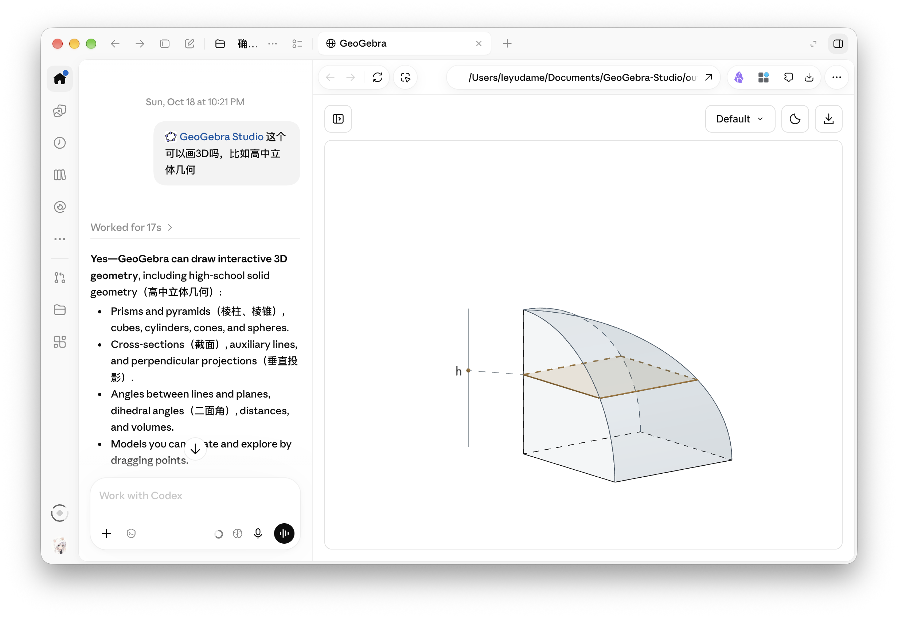
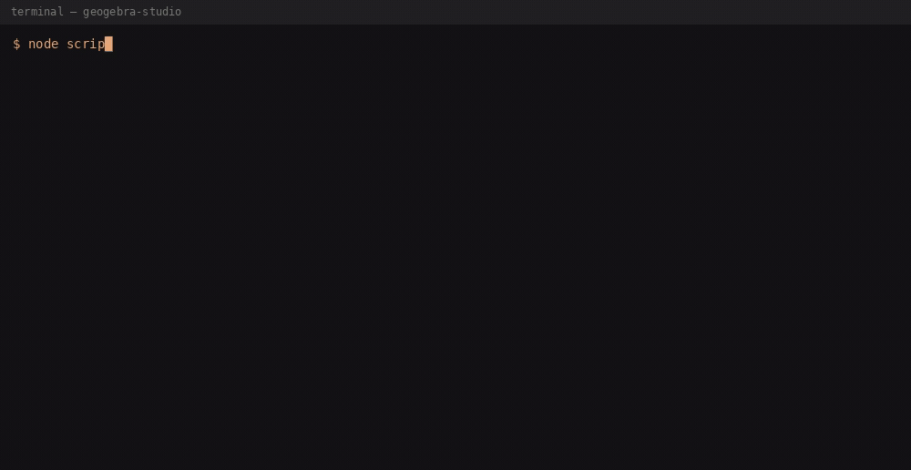
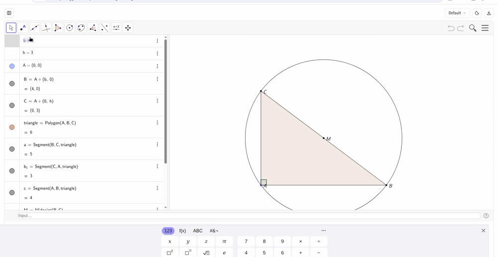
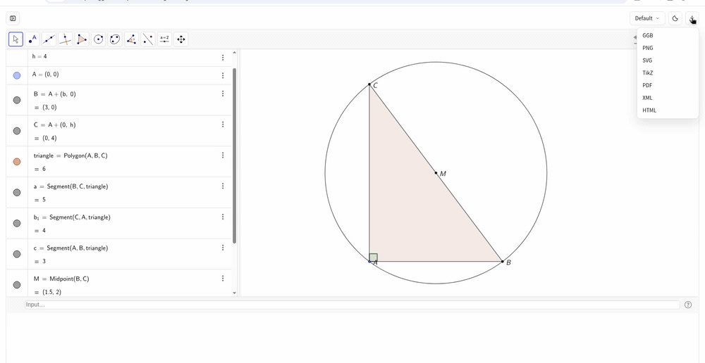

# GeoGebra Studio

[](https://github.com/YZDame/GeoGebra-Studio/actions/workflows/check.yml) [](LICENSE) [](https://nodejs.org/) [](https://github.com/YZDame/GeoGebra-Studio/stargazers)

**A portable Agent Skill for editable mathematical constructions.** Describe a 2D or 3D figure, generate a local interactive GeoGebra HTML, inspect and edit it in a browser, then export the current construction.

[English](README.md) · [简体中文](README.zh-CN.md) · [繁體中文](README.zh-TW.md) · [Español](README.es.md) · [Français](README.fr.md) · [Deutsch](README.de.md) · [日本語](README.ja.md) · [한국어](README.ko.md) · [Português (Brasil)](README.pt-BR.md)

## How it works



| Generate | Edit | Export |
| --- | --- | --- |
|  |  |  |
| From commands JSON → local interactive viewer (pre-fitted). | Change a free value. Dependent objects keep their relationships. | One construction. Seven formats from the real Download menu. |

## What it does

- Native editable GeoGebra figures with free/dependent objects and Algebra View.
- Responsive 2D/3D viewer, nine theme families, light/dark mode and a toolbar outside the canvas.
- Seven in-viewer downloads: **GGB, HTML, PNG, SVG, PDF, XML, TikZ**.
- Additional local **Asymptote** and **mixed TSQX/Asymptote** source exports from GeoGebra XML.
- Bundled Gikz cleans native GeoGebra PGF before TikZ export.
- No MCP server, backend, database or separate Chrome setup for normal usage.

**Requirements:** Node.js 22.12+ and internet access when opening a generated HTML (GeoGebra's official engine is loaded remotely). No separate GeoGebra Studio npm installation is required for the standalone Skill.

## Install as an Agent Skill (recommended)

In an Agent Skills-compatible environment, install from the GitHub repository and select `geogebra-studio`:

```sh
npx skills add YZDame/GeoGebra-Studio --skill geogebra-studio
```

Alternatively, copy **the entire** `skills/geogebra-studio/` folder into your agent's skills directory. It must contain `SKILL.md`, `scripts/`, `references/`, and the bundled `runtime/`. The runtime is packaged with the Skill; do not copy only SKILL.md. The CLI uses Node.js built-ins and bundled code, without `npm install`.

Agents need file-write/shell access. Open HTML in the client's built-in browser when available, or a normal browser. A built-in browser pane is **not** a universal Agent Skills feature. Native plugin installation is developed for Codex and DeepSeek Harness; other clients require environment-specific verification.

## DeepSeek Harness

DeepSeek Harness (`dsh`) can use GeoGebra Studio in two separate ways: install the Agent Skill for other clients, or install the full plugin, which provides the tools and the Skill itself. The published `SKILL.md` already has the required kebab-case `name` and `description`, so that frontmatter stays as published. The plugin is a separate package at [`plugins/dsh-geogebra-studio/`](plugins/dsh-geogebra-studio/); do not run `dsh plugin add` on the repository root, on `@lydt/geogebra-studio`, or on `skills/geogebra-studio/`.

Use the same installer as the other Agent Skills clients. In its default mode it writes a full copy to `.agents/skills/geogebra-studio`, which DeepSeek Harness already scans:

- Without `-g`, the command writes `./.agents/skills/geogebra-studio` in the current directory. DeepSeek Harness discovers it when that project's Git root is the workspace. If the installer asks for a scope, the project choice is this path.
- With `-g`, or Global when the installer asks, it writes `~/.agents/skills/geogebra-studio`. DeepSeek Harness scans that directory for every workspace.

```sh
npx skills add YZDame/GeoGebra-Studio --skill geogebra-studio
```

Pass `-g` for the home-directory copy. The installer may also link the Skill into a client folder such as `~/.claude/skills` or `~/.cursor/skills`. DeepSeek Harness scans `~/.dsh/skills`, `~/.agents/skills`, and the project directories `.dsh/skills` and `.agents/skills`. Keep the default install mode so the `.agents/skills` copy is written. `--copy` skips that directory and writes only to the selected client's own folder.

To install by hand, copy the **entire** `skills/geogebra-studio/` folder — `SKILL.md`, `scripts/`, `references/`, and `runtime/` — into one of these directories:

- `~/.dsh/skills/geogebra-studio`
- `~/.agents/skills/geogebra-studio`

In chat, invoke it with `/geogebra-studio`.

Opening this repository as a DeepSeek Harness workspace does not discover `skills/geogebra-studio/`. Discovery reads only the immediate children of `.dsh/skills` and `.agents/skills`. Copy the whole folder into `.dsh/skills/geogebra-studio` or `.agents/skills/geogebra-studio` inside the workspace. Prefer `.dsh/skills/geogebra-studio` for that workspace copy: it is specific to DeepSeek Harness and leaves `.agents/skills` free for `npx skills`. This repository does not commit that copy or a symlink. Git on Windows often checks a symlink out as a plain text file, and `.agents/skills` is the install directory already used by Codex, Cursor, and `npx skills`. The existing `.agents/plugins` file remains the optional Codex marketplace record.

### Plugin: tools, skill and sidebar panel

Install the plugin into the web profile, then restart `dsh web`. Quote the GitHub spec so pnpm keeps the subdirectory:

```sh
dsh plugin --profile web add "github:YZDame/GeoGebra-Studio#main&path:plugins/dsh-geogebra-studio"
```

From a checkout of this repository:

```sh
dsh plugin --profile web add ./plugins/dsh-geogebra-studio
```

The same package now does the work instead of opening a guide:

- `geogebra_build` writes a new editable HTML construction from a JSON spec.
- `geogebra_preview` serves that file on a loopback URL and returns the link for the reply.
- `geogebra_export` produces strict TSQX/Asymptote from GeoGebra XML, or cleaned TikZ from native PGF.
- It registers the `geogebra-studio` skill, so `npx skills add` is unnecessary in DeepSeek Harness.
- **Plugins** shows its title, description and icon. The sidebar-foot **GeoGebra** button, above Settings, opens a quick-start panel with the tool list and a starter prompt.

Ask for a figure in chat:

> Draw a circle through three points, show the preview, then export TikZ.

Generation is offline and writes new files only. Rendering loads the official GeoGebra engine, so the browser needs internet access; the plugin cannot watch the canvas and reports visual verification as not performed unless you confirm the drawing. Edits made in the viewer are not written back: download current HTML or GGB before leaving. The plugin is self-contained, with no MCP server, backend, Chrome setup or separate Skill copy.

On Windows, an older `dsh` can hand the GitHub spec to `cmd.exe`, which treats `&` as a command separator and installs the repository root instead. Use the checkout path in that case. GeoGebra Studio is an independent community project and is not affiliated with GeoGebra.

## Optional Codex Plugin

The Codex distribution is a convenience wrapper around the same Skill. Install the latest published version from npm:

```sh
npx @lydt/geogebra-studio@latest install
```

Restart the Codex session so installed Skills are reloaded. For source development, run `npm ci && npm run build`, then `node dist/cli.js install --local`.

## Quick start

Write `diagram.json` in your working directory:

```json
{
  "filename": "circle.html",
  "commands": ["A=(0,0)", "B=(4,0)", "c=Circle(A,B)"],
  "visibleLabels": ["A", "B"]
}
```

Then ask your agent to use the installed `geogebra-studio` Skill. Or run directly:

```sh
node /path/to/geogebra-studio/scripts/geogebra-studio.cjs generate --input /absolute/project/diagram.json --workspace /absolute/project
```

When an agent client can access loopback URLs, the Skill starts a single-document HTTP preview by default. Prefer that over an HTML file-preview pane, which can block GeoGebra's remote engine scripts:

```sh
node /path/to/geogebra-studio/scripts/geogebra-studio.cjs preview --input /absolute/project/diagram.html --workspace /absolute/project
```

The agent opens the returned URL in the client's browser sidebar or tab, puts it first in the reply as **Open interactive preview**, and keeps the process running. The server serves only the selected HTML snapshot. Restart it after changing the file. Opening a file-preview tab is not browser verification. If the client rejects access for security reasons, stop and report the restriction; do not change transports to evade it. Report rendering as successful only after `window.geogebraStudio.status === "ready"` and the drawing looks correct in the intended browser.

The reply also includes the HTML download. If the client cannot access the preview URL, download the HTML and open it directly in Chrome, Safari, or another regular browser. Both viewing paths require the browser to reach the official GeoGebra engine online. Generating the HTML can be done offline.

The generator writes **new files only**; it does not execute or validate the geometry. The viewer reports errors, but a mathematical/visual check requires inspection of the actual figure.

## Edit, save and export

Drag free points or open the native object editor using the toolbar's left button. Theme and download controls are aligned to the right. User edits are not automatically written back to the original JSON/HTML: **download current HTML or GGB before closing or refreshing.** Current HTML embeds packed GGB and preserves edits when reopened.

For additional source formats, download the current XML from the viewer (or obtain `await window.geogebraStudio.snapshot()` in the page), then run:

```sh
node /path/to/geogebra-studio/scripts/geogebra-studio.cjs export --input /absolute/project/figure.xml --format tsqx --workspace /absolute/project --output figure.tsqx
node /path/to/geogebra-studio/scripts/geogebra-studio.cjs export --input /absolute/project/figure.xml --format asymptote --workspace /absolute/project --output figure.asy
```

These exports cover a documented semantic subset and reject unsupported dependencies rather than silently freezing them. TSQX is **mixed TSQX/Asymptote**, not pure TSQX. TikZ is a static visual snapshot generated via native GeoGebra PGF and bundled Gikz.

## Architecture

`Agent → SKILL.md → construction JSON → bundled local CLI/HTML viewer → official GeoGebra applet → current-state files`

The one Skill uses progressively loaded `references/` for construction, export, visual standards and troubleshooting. The standalone runtime and the Codex Plugin share the same build sources. The project ships no MCP server.

### Showcase examples

| Level | Spec | Idea |
| --- | --- | --- |
| Middle school | [`examples/napoleon.json`](examples/napoleon.json) | Napoleon's theorem — outer equilateral triangles, inner equilateral that survives dragging |
| High school | [`examples/nine-point-circle.json`](examples/nine-point-circle.json) | Nine-point circle and Euler line |
| University | [`examples/hyperboloid-ruled.json`](examples/hyperboloid-ruled.json) | One-sheet hyperboloid with both ruling families (3D) |
| Showcase | [`examples/cycloid.json`](examples/cycloid.json) | Cycloid: move the slider to roll a circle and trace a point on its rim |

More 2D and 3D constructions are listed in the [example gallery](examples/README.md).

See [teacher walkthrough](docs/TEACHER-QUICKSTART.md), [sample constructions](examples/), [architecture](docs/MODERNIZATION.md), and [contributing](CONTRIBUTING.md).

## Develop and verify

```sh
npm ci
npm run verify
npm run test:unit
```

Optional browser/real-engine verification requires an available Chrome executable and internet. A clean Skill install is checked without installing dependencies inside the installed Skill.

GeoGebra Studio is an independent community project, not affiliated with GeoGebra. Combined distribution: GPL-2.0-or-later. Third-party notices and prior MIT attributions are retained in [LICENSE](LICENSE), [LICENSE-MIT](LICENSE-MIT) and [THIRD_PARTY_NOTICES.md](THIRD_PARTY_NOTICES.md).
