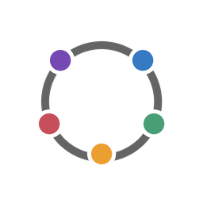
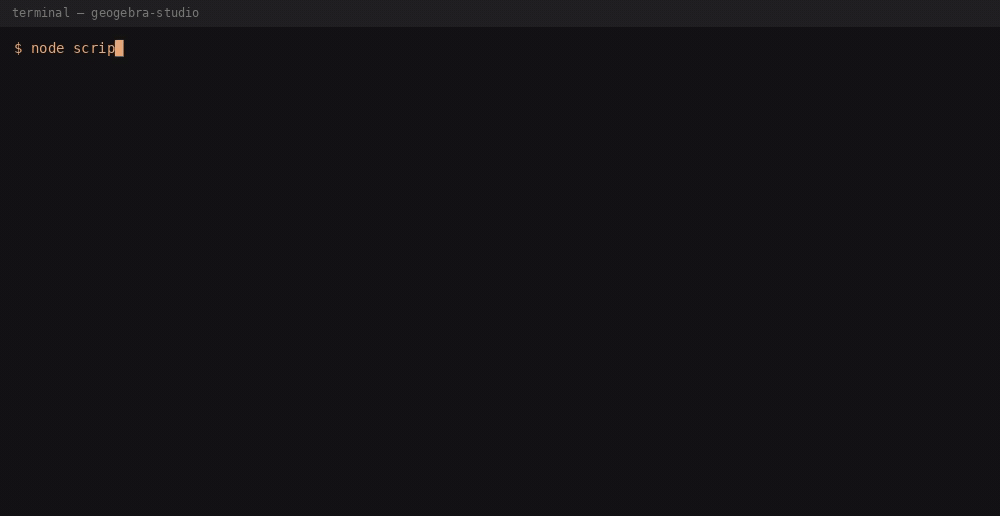

<p align="center"></p>
<h1 align="center">GeoGebra Studio</h1>

<p align="center">
  <a href="skills/geogebra-studio/SKILL.md"></a>
  <a href="https://yzdame.github.io/GeoGebra-Studio/"></a>
  <a href="https://www.npmjs.com/package/@lydt/geogebra-studio"></a>
  <a href="https://www.npmjs.com/package/dsh-geogebra-studio"></a>
  <a href="https://www.npmjs.com/package/@lydt/geogebra-studio"></a>
  <a href="LICENSE"></a>
  <a href="https://nodejs.org/"></a>
  <a href="https://github.com/YZDame/GeoGebra-Studio/stargazers"></a>
</p>

**GeoGebra Studio** é uma **Agent Skill** padrão (com plugins opcionais para Codex e DeepSeek Harness). No Claude Code, Codex, Cursor, DeepSeek Harness ou qualquer cliente compatível com Agent Skills, descreva para a IA o que deseja desenhar — ou envie um documento ou imagem de referência — para gerar uma página interativa do GeoGebra em 2D ou 3D que você pode arrastar, editar e exportar. Quer experimentar antes? Explore a [galeria interativa no GitHub Pages](https://yzdame.github.io/GeoGebra-Studio/) direto no navegador, sem instalar nada.

[English](README.md) · [简体中文](README.zh-CN.md) · [繁體中文](README.zh-TW.md) · [Español](README.es.md) · [Français](README.fr.md) · [Deutsch](README.de.md) · [日本語](README.ja.md) · [한국어](README.ko.md) · [Português (Brasil)](README.pt-BR.md)

## Início rápido

1. **Instale a Agent Skill** (requer Node.js 22.12 ou superior; veja [Instalação](#instalação) abaixo para os plugins do Cursor, Codex e DeepSeek Harness):

   ```sh
   npx skills add YZDame/GeoGebra-Studio --skill geogebra-studio
   ```

2. **Peça para a IA desenhar**, ou envie um documento com a questão ou uma imagem de referência (as opções de envio dependem do seu cliente de IA):

   > Desenhe um triângulo e sua circunferência circunscrita. Deixe os vértices arrastáveis.

3. **Interaja, edite e exporte**: Abra a página gerada para arrastar pontos e ajustar valores, ou peça novas alterações à IA. **Baixe o HTML ou GGB atual antes de fechar ou atualizar a página para salvar suas edições.**

| Gerar | Editar | Exportar |
| --- | --- | --- |
|  |  |  |

## Recursos

- Figuras GeoGebra em 2D e 3D com pontos arrastáveis, valores ajustáveis, nove famílias de temas e modos claro/escuro.
- Baixe **HTML, GGB, PNG, SVG, PDF, XML e TikZ** diretamente da página.
- Exporte código-fonte em **Asymptote** e **TSQX/Asymptote misto** pela IA; consulte os [detalhes de exportação](skills/geogebra-studio/references/exports.md).
- Fluxo portátil baseado em [`SKILL.md`](skills/geogebra-studio/SKILL.md), sem servidor MCP, backend ou banco de dados.

## Instalação

Use no macOS, Windows ou Linux com **Node.js 22.12 ou superior**. Seu cliente de IA precisa de acesso a arquivos e terminal. Para abrir uma página gerada, é necessário acesso à Internet para carregar o mecanismo oficial do GeoGebra.

**Escolha um dos métodos abaixo de acordo com o seu cliente de IA:**

### 1. Instalação geral como Agent Skill (recomendada)

Para Claude Code, Cursor, Codex e outros clientes compatíveis com Agent Skills. Siga as instruções na tela para escolher o cliente e o escopo da instalação.

```sh
npx skills add YZDame/GeoGebra-Studio --skill geogebra-studio
```

Você também pode copiar toda a pasta [`skills/geogebra-studio/`](skills/geogebra-studio/) para o diretório de Skills do seu cliente, mantendo todos os arquivos junto com `SKILL.md`.

### 2. Instalar no Codex (plugin opcional)

Execute o instalador do plugin para Codex e abra uma nova sessão do Codex.

```sh
npx @lydt/geogebra-studio@latest install
```


### 3. Instalar no DeepSeek Harness (tela interativa na barra lateral)

No aplicativo de desktop, abra **Plugins → Add Plugin**, cole o nome do pacote abaixo e instale. O plugin já inclui a skill `geogebra-studio`, portanto não é necessário instalar a Skill separadamente.

```text
dsh-geogebra-studio
```

Abra o **GeoGebra Studio** na barra lateral esquerda para usar a tela interativa ao lado do seu chat. Veja o [guia do plugin](plugins/dsh-geogebra-studio/) para instalação via linha de comando.


### 4. Instalar no Cursor (plugin)

Depois da publicação, instale o **GeoGebra Studio** no marketplace do Cursor. Antes disso, copie este repositório para `~/.cursor/plugins/local/geogebra-studio` de modo que a cópia contenha `.cursor-plugin/plugin.json` e recarregue o Cursor. É necessário o Node.js 22.12 ou posterior. Peça ao Cursor para desenhar uma figura; a skill incluída `geogebra-studio` grava um HTML local. Abrir essa página exige um navegador que alcance o mecanismo oficial do GeoGebra.

A instalação da Agent Skill da seção 1 também funciona no Cursor.

Consulte [instalação e solução de problemas](skills/geogebra-studio/references/installation.md) para mais detalhes.

## Recursos adicionais

[Exemplos](examples/README.md) · [Galeria interativa](https://yzdame.github.io/GeoGebra-Studio/) · [Especificação da Skill](skills/geogebra-studio/SKILL.md) · [Desenvolvimento e contribuição](CONTRIBUTING.md)

Projeto comunitário independente, sem afiliação com a GeoGebra. Licenciado sob [GPL-2.0-or-later](LICENSE), preservando as [atribuições MIT anteriores](LICENSE-MIT) e os [avisos de terceiros](THIRD_PARTY_NOTICES.md).
