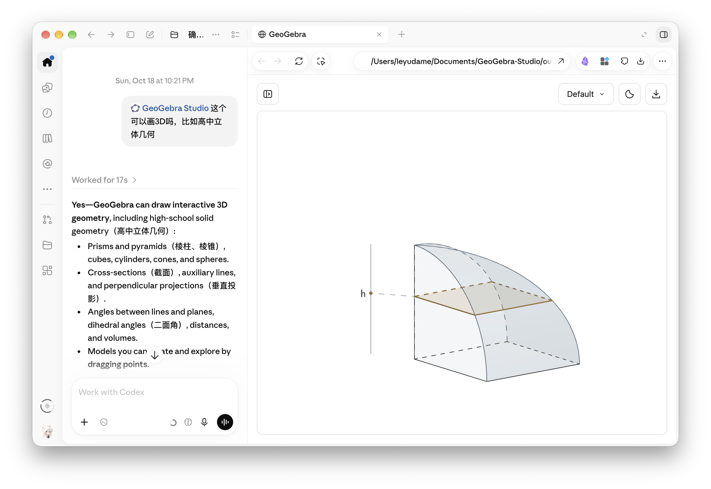

<p align="center"></p>
<h1 align="center">GeoGebra Studio</h1>

<p align="center">
  <a href="skills/geogebra-studio/SKILL.md"></a>
  <a href="https://yzdame.github.io/GeoGebra-Studio/"></a>
  <a href="https://www.npmjs.com/package/@lydt/geogebra-studio"></a>
  <a href="https://www.npmjs.com/package/dsh-geogebra-studio"></a>
  <a href="https://www.npmjs.com/package/@lydt/geogebra-studio"></a>
  <a href="LICENSE"></a>
  <a href="https://nodejs.org/"></a>
  <a href="https://github.com/YZDame/GeoGebra-Studio/stargazers"></a>
</p>

**GeoGebra Studio** 是一个标准的 **Agent Skill**（同时提供 Codex 与 DeepSeek Harness 插件）。在 Claude Code、Codex、Cursor、DeepSeek Harness 等 AI 客户端中，把想画的图用文字告诉 AI，或者直接发题目文档、参考图，就能生成一个可交互的 2D/3D GeoGebra 页面——支持拖动点、调整参数，也能导出成多种格式。想先直接体验效果？无需安装即可打开[在线交互示例（GitHub Pages）](https://yzdame.github.io/GeoGebra-Studio/)。

[English](README.md) · [简体中文](README.zh-CN.md) · [繁體中文](README.zh-TW.md) · [Español](README.es.md) · [Français](README.fr.md) · [Deutsch](README.de.md) · [日本語](README.ja.md) · [한국어](README.ko.md) · [Português (Brasil)](README.pt-BR.md)

## 快速开始

1. **安装 Agent Skill**（需要 Node.js 22.12 或更高版本；Cursor、Codex 或 DeepSeek Harness 插件请看下方[详细安装](#详细安装)）：

   ```sh
   npx skills add YZDame/GeoGebra-Studio --skill geogebra-studio
   ```

2. **向 AI 提出作图需求**，或者上传题目文档、参考图（上传方式取决于你使用的 AI 客户端）：

   > 画一个三角形和它的外接圆，顶点可以拖动。

3. **交互、修改与导出**：打开生成的页面即可拖动点、调整数值，也可以继续让 AI 修改。**关闭或刷新前，请下载当前 HTML 或 GGB，保存你的修改。**

| 生成 | 编辑 | 导出 |
| --- | --- | --- |
|  |  |  |

## 功能特性

- 平面（2D）与立体（3D）作图，支持拖动点、调整数值、9 套主题配色与深浅色模式。
- 页面内直接下载 **HTML、GGB、PNG、SVG、PDF、XML、TikZ**。
- 通过 AI 另行导出 Asymptote 和混合 TSQX/Asymptote 源码，详见[导出说明](skills/geogebra-studio/references/exports.md)。
- 基于标准 [`SKILL.md`](skills/geogebra-studio/SKILL.md) 工作流，无需 MCP 服务器、后端服务或数据库。

## 详细安装

可在 macOS、Windows 和 Linux 上使用。需要 **Node.js 22.12 或更高版本**，AI 客户端需支持读写文件和运行命令。打开生成的页面时需要联网加载 GeoGebra 官方引擎。

**根据你使用的 AI 客户端，任选以下一种方式安装：**

### 1. 通用 Agent Skill 安装（推荐）

适用于 Claude Code、Cursor、Codex 等支持 Agent Skills 的客户端。按提示选择客户端和安装范围。

```sh
npx skills add YZDame/GeoGebra-Studio --skill geogebra-studio
```

也可以把整个 [`skills/geogebra-studio/`](skills/geogebra-studio/) 文件夹复制到客户端的 Skills 目录，保留其中的全部文件。

### 2. 在 Codex 中安装（可选插件）

运行 Codex 插件安装命令，然后新开一个 Codex 会话。

```sh
npx @lydt/geogebra-studio@latest install
```



### 3. 在 DeepSeek Harness 中安装（带右侧交互画布）

在桌面端打开 **插件 → 添加插件**，粘贴下面的包名即可安装。该插件已内置 `geogebra-studio` Skill，无需再单独执行通用安装命令。

```text
dsh-geogebra-studio
```

安装后，从左侧栏打开 **GeoGebra Studio**，就能在对话旁使用交互画布。命令行安装见[插件说明](plugins/dsh-geogebra-studio/)。


### 4. 在 Cursor 中安装（插件）

上架 Cursor 插件市场后，可在 Cursor 里安装 **GeoGebra Studio**。在上架前，把本仓库复制到 `~/.cursor/plugins/local/geogebra-studio`，使该目录包含 `.cursor-plugin/plugin.json`，然后重新加载 Cursor。需要 Node.js 22.12 或更高版本。让 Cursor 画一张图时，内置的 `geogebra-studio` Skill 会写出本地 HTML。打开该页面的浏览器需要能访问 GeoGebra 官方引擎。

第 1 节的 Agent Skill 安装方式在 Cursor 中同样可用。

更多安装细节见[安装与排障](skills/geogebra-studio/references/installation.md)。

## 相关资料

[示例](examples/README.md) · [在线交互示例（GitHub Pages）](https://yzdame.github.io/GeoGebra-Studio/) · [Skill 定义](skills/geogebra-studio/SKILL.md) · [开发与贡献](CONTRIBUTING.md)

本项目由社区独立开发，与 GeoGebra 官方无隶属关系。采用 [GPL-2.0-or-later](LICENSE) 许可，保留[原 MIT 许可](LICENSE-MIT)与[第三方声明](THIRD_PARTY_NOTICES.md)。
