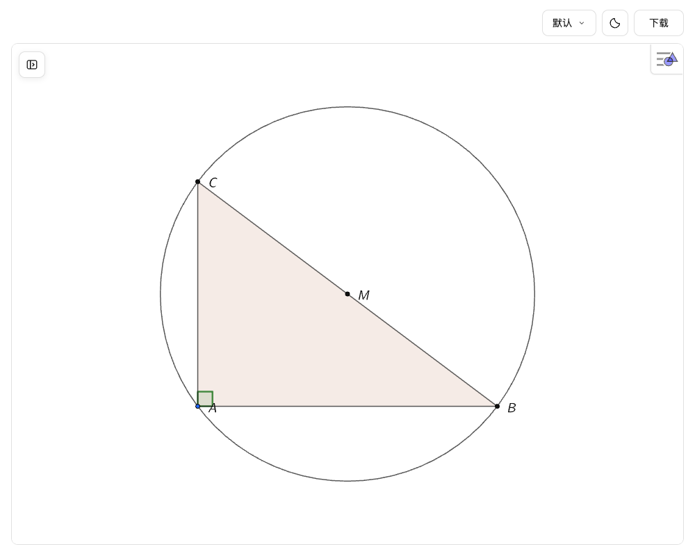

# GeoGebra Studio

**可攜式 Agent Skill：產生、編輯與匯出互動式數學幾何圖形。** 只要描述 2D 或 3D 幾何構造，Agent 就能產生本機 GeoGebra HTML，並透過瀏覽器檢視、拖曳和編輯。

[English](README.md) · [简体中文](README.zh-CN.md)



## 核心功能

- 官方 GeoGebra 引擎，保留自由點、相依物件、代數檢視及 2D/3D 構造。
- 自適應畫布、九種配色主題與明暗模式；操作工具列位於畫布外側。
- 內建七種下載格式：**GGB、HTML、PNG、SVG、PDF、XML、TikZ**。
- 將目前構造的 XML 匯出為 **Asymptote** 或 **混合 TSQX/Asymptote** 原始碼。
- TikZ 使用 GeoGebra 原生 PGF，並經由隨附的 Gikz 清理。
- 日常使用不需要 MCP Server、獨立後端、資料庫或額外的 Chrome 自動化環境。

**系統需求：** Node.js 22.12 以上；開啟 HTML 時必須連網載入 GeoGebra 官方引擎。獨立 Skill 已包含必要的產生程式及資源，無須另行安裝 npm 套件。

## 安裝 Agent Skill（建議）

在支援 Agent Skills 的環境中，從 GitHub 安裝 `geogebra-studio`：

```sh
npx skills add YZDame/GeoGebra-Studio --skill geogebra-studio
```

也可以將**整個** `skills/geogebra-studio/` 資料夾複製到 Agent 的 Skills 目錄，必須同時保留 `SKILL.md`、`references/`、`scripts/` 與 `runtime/`。請勿只複製 `SKILL.md`；複製後不需要再執行 `npm install`。

Agent 需要具備檔案寫入與終端機指令執行權限。優先使用客戶端內建瀏覽器；若不提供側邊瀏覽器，可使用一般瀏覽器。不同 Agent 對 Skill 的安裝與瀏覽器存取支援程度不一定相同。

## 可選的 Codex Plugin

Codex Plugin 是額外的發佈方式，而不是使用 Skill 的必要條件。正式發佈相容版本後，可以使用：

```sh
npx @lydt/geogebra-studio@0.5.0 install
```

安裝後請重新開啟 Codex 工作階段。本次 PR **尚未發佈 0.5.0**；發佈前請使用已建置的原始碼資料夾或獨立 Skill。原始碼開發指令為 `npm ci && npm run build`，本地 Codex 安裝則使用 `node dist/cli.js install --local`。

## 快速開始

建立 `diagram.json`：

```json
{
  "filename": "circle.html",
  "commands": ["A=(0,0)", "B=(4,0)", "c=Circle(A,B)"],
  "visibleLabels": ["A", "B"]
}
```

讓 Agent 依照 Skill 執行，或直接透過終端機：

```sh
node /path/to/geogebra-studio/scripts/geogebra-studio.cjs generate --input /absolute/project/diagram.json --workspace /absolute/project
```

用瀏覽器開啟產生的 HTML。若內建瀏覽器不支援 `file://`，可使用僅繫結 `127.0.0.1` 的臨時靜態伺服器：

```sh
python3 -m http.server 8765 --bind 127.0.0.1 --directory /absolute/project
```

產生器只會建立新檔案，不覆寫既有檔案，也不會在產生階段執行幾何指令。必須檢視實際的 GeoGebra 畫面，確認幾何關係、交點分支、比例、標籤及拖曳效果。

## 編輯與匯出

工具列左側按鈕可展開 GeoGebra 代數檢視；右側為主題、明暗模式與下載選單。**手動編輯不會自動更新原始 JSON 或 HTML**，關閉或重新整理頁面前，請下載目前的 HTML 或 GGB。已下載的 HTML 會嵌入目前的 GGB，重新開啟可保留編輯結果。

要轉換為 TSQX 或 Asymptote，先從 Viewer 下載目前的 XML，或在頁面中執行 `await window.geogebraStudio.snapshot()` 取得 XML，再執行：

```sh
node /path/to/geogebra-studio/scripts/geogebra-studio.cjs export --input /absolute/project/figure.xml --format tsqx --workspace /absolute/project --output figure.tsqx
node /path/to/geogebra-studio/scripts/geogebra-studio.cjs export --input /absolute/project/figure.xml --format asymptote --workspace /absolute/project --output figure.asy
```

語意轉換只涵蓋已驗證的構造類型；遇到不支援的相依關係會明確報錯，不會偷偷固定座標。TSQX 為混合 TSQX/Asymptote，**不是純 TSQX**。TikZ 則是經 Gikz 清理的靜態視覺圖。

## 架構、測試與授權

`Agent → SKILL.md → 構造 JSON → 本機 CLI/HTML Viewer → 官方 GeoGebra 引擎 → 目前狀態匯出`

詳細指引會從 `references/` 按需載入。通用 Skill 與 Codex Plugin 共用相同來源，不提供 MCP Server。

參考：[教師入門指南](docs/TEACHER-QUICKSTART.zh-CN.md)、[範例](examples/)、[架構說明](docs/MODERNIZATION.md)、[貢獻指南](CONTRIBUTING.md)。

開發驗證：`npm ci`、`npm run verify`、`npm run test:unit`。額外的真實 GeoGebra/瀏覽器測試需要 Chrome 與網路，但日常使用並不需要額外的 Chrome 安裝。

本專案與 GeoGebra 官方無隸屬關係。整體授權採 GPL-2.0-or-later；保留原有 MIT 與第三方聲明，詳見 [LICENSE](LICENSE)、[LICENSE-MIT](LICENSE-MIT)、[THIRD_PARTY_NOTICES.md](THIRD_PARTY_NOTICES.md)。
