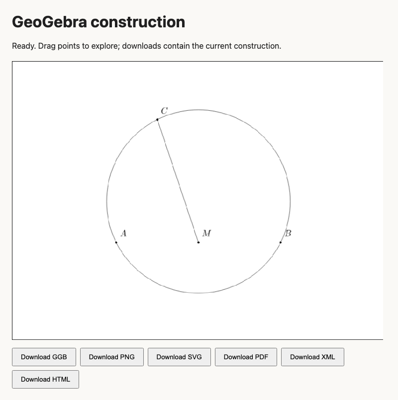

# Validation evidence — 2026-10-11

Validated locally on macOS with Node 25.2.1, official MCP SDK 1.32.1,
MCP Apps helpers 2.0.3, Puppeteer 25.13.0, and installed Google Chrome.
The Node minimum in package.json follows dependency requirements; Node 22 itself
was not exercised in this run.

## Exercised paths

- TypeScript build and self-contained MCP Apps widget bundle.
- Official SDK stdio client: negotiation, tools, argument rejection, unknown tools,
  resource reads, prompts, and backward-compatible echo output.
- Official Streamable HTTP client: original 16-tool core profile, structured tool result,
  no session ID, and untrusted Origin rejection. Temporary loopback port closed.
- Three focused Jest suites: **37 tests passed** (server contract, semantic export,
  and existing error handling). This is not a claim that the entire historical
  integration/performance suite was run.
- Real GeoGebra commands: free points, midpoint, segment, and three-point circle.
  Original XML retains command dependencies. No extra health-probe object appears.
- Native GGB/PNG/SVG/PDF exports. The packed GGB reopens in a fresh applet; direct
  base64 loading also preserves objects and midpoint coordinates.
- Real HTML button downloads: GGB, PNG, SVG, PDF, XML, and HTML, written by Chrome.
  Reopening saved HTML retains the changed coordinate of a dragged/edited point.
  Fit view uses equal axis scales; screenshots were inspected.
- TikZ, Asymptote, and mixed TSQX/Asymptote sources compile to PDF. Rendered output
  was compared. A compile-only check initially missed a TikZ length-unit error;
  `verify-source.cjs` now checks the actual compiled circumcenter coordinates
  against the fixture's known center (2,1).
- External Gikz XML conversion at pinned reference revision produces standalone
  TikZ and compiles. Gikz remains outside this MIT repository.
- Portable plugin and MCP manifests validate against the published Agent Plugins
  1.0.0 JSON schemas. All three skills pass Skill Creator's frontmatter validator.
- npm pack dry run includes dist/widget.html, both plugin formats, and all skills.
- Apps API bridge build and stdio negotiation: 53 full-profile tools; core profile
  exposes 19 tools, including method discovery, invocation, and callback event reads.
- Local Codex marketplace registration and plugin installation completed at
  `geogebra-geometry@geogebra-local` version 0.3.1. The installed manifest points
  to this local checkout for its MCP process. The live Apps API call could not be
  smoke-tested in the restricted shell because Chromium failed to launch there.
- `npm audit --omit=dev`: **0 known runtime vulnerabilities** after updates.
  The legacy development dependency tree still reports findings; a full test/lint
  tooling upgrade is separate work.

## Reproduce

```sh
npm run verify
npx jest --runInBand tests/server.test.ts tests/unit/semantic-export.test.ts tests/unit/errors.test.ts
GEOGEBRA_TOOL_PROFILE=core node scripts/verify-http.cjs
node scripts/verify-native.cjs
node scripts/verify-html.cjs
GIKZ_CLI=/absolute/path/to/Gikz/gikz.js node scripts/verify-exports.cjs
node scripts/verify-source.cjs
```

Set `PUPPETEER_EXECUTABLE_PATH` if using installed Chrome. Native/browser checks
need network access. `verify-source.cjs` needs `pdflatex`, `asy`, and `tsqx`.
Artifacts are retained locally in ignored `output/verification/`; the reproducible
interactive example is [triangle.html](../examples/triangle.html). The Chinese problem example is [circle-tangency.html](../examples/circle-tangency.html); it includes an editable construction for the two circles and the moving point A, together with a single export selector.



## Boundaries

- Codex plugin files are installed and enabled, but the desktop UI has not yet been
  restarted or exercised with a new conversation. No ChatGPT sandbox validation was
  performed. The MCP Apps resource and bridge are implemented, but host CSP,
  download permissions, and GeoGebra assets must still be checked in that host.
- No remote deployment, public plugin submission, or npm publication was performed.
- MCP protocol coverage is the SDK's actual supported range, through 2025-11-25.
  This does not implement the newer 2026-07-28 stateless/discovery revision.
- Geometry export is an explicit subset. Unsupported objects, branch choices, and
  coordinate fallbacks require review or AI reconstruction from original XML.
  Presentation fidelity is limited as stated in result warnings.
- Tests use representative 2D constructions; arbitrary 3D geometry, large projects,
  macros, animation exports, CAS, and non-Latin label/font workflows remain outside
  this validation. GeoGebra CDN availability can vary; initialization failures are
  surfaced rather than converted into placeholder files.
- Apps API bridge enumerates and calls methods available in the running applet.
  Methods requiring DOM/browser-specific values still need dedicated wrappers.
